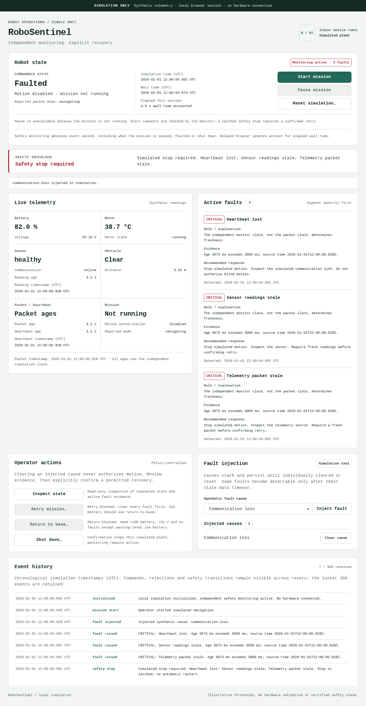
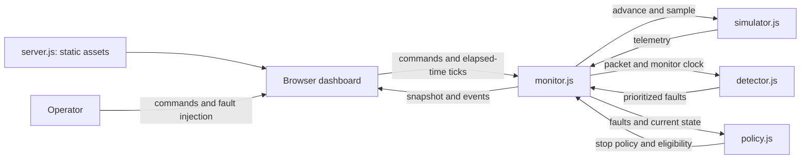

# RoboSentinel

### Intelligent Robot Monitoring and Fault Response

A local robot-monitoring prototype for understanding **what failed, why motion
stopped, and when recovery is permitted**. RoboSentinel combines a deterministic
telemetry simulator, explainable fault rules, a simulated safety-response policy
and a browser dashboard—without API keys or runtime dependencies.

Robotics students, software engineers and operator-interface reviewers can use
it to reproduce fault combinations, inspect evidence and test recovery
restrictions before introducing hardware. The goal is observable, testable
systems behaviour, not a chatbot or an unsupported claim of ML intelligence.

> **Simulation only.** This project does not control real robots, motors or
> actuators. It is not a certified functional-safety system. Its thresholds and
> recovery rules are illustrative software policies, not guarantees of physical safety.

[Quick start](#quick-start) · [Demonstration](#visual-demonstration) ·
[Architecture](#architecture) · [Fault behaviour](#fault-behaviour) ·
[Verification](#verification-and-reproducibility) · [Contributing](#contributing)

## Project status

| Area | Status | Evidence / scope |
| --- | --- | --- |
| Core behaviour, HTTP surface and contrast tokens | **VERIFIED** | 51 tests passed; no failures or skips |
| JavaScript syntax and deterministic demos | **VERIFIED** | 15 files; 3 scenario transcripts passed |
| Rendered dashboard | **VERIFIED** | 15 automated Chromium journeys, including keyboard and narrow layouts |
| Clean local checkout | **VERIFIED** | Offline root install, checks and server/route smoke tests passed |
| Docker image and hosted CI | **NOT TESTED** | Recipes exist; no successful Docker build or hosted run is claimed |
| Hardware, Safari/Firefox and manual screen-reader use | **NOT TESTED** | Outside the current evidence |
| Public repository and Buildathon entry | **BLOCKED** | Workspace CLI authentication/public URL and final submission still need verification |

These are local verification results, not coverage percentages, deployment
badges or certification. Details and limitations are in
[`docs/verification.md`](docs/verification.md).

## Visual demonstration

### Overheating: evidence, stop and rejected restart


The injected motor temperature is 95 °C. The dashboard shows the critical rule,
supporting evidence and recommended inspection. Commanded state is **Faulted**,
motion is disabled, and the rejected Start request is retained in event history.

<details>
<summary><strong>Communication loss: stale reported state is not commanded state</strong></summary>



After the frozen packet becomes more than three seconds old, the monitor raises
heartbeat, sensor-stale and packet-stale faults. The last packet still reports
**navigating**, but the independent commanded state is **faulted** with motion
disabled. Old telemetry is never used as proof of current motion authorization.

</details>

These are genuine, unmodified captures from the local Chromium QA harness with
synthetic telemetry and controlled test clocks. Other captures show the
[healthy/paused scene](docs/evidence/healthy-desktop.png),
[390px layout](docs/evidence/narrow-screen.png) and an
[intentional module-loading error](docs/evidence/module-error.png).
There is no hosted application or recorded-video link to claim.

## Key capabilities

- **Deterministic telemetry:** seeded battery/voltage, motor temperature/state,
  sensor health/link, obstacle distance, heartbeat, packet time and robot mode.
  Equal seeds and time-step sequences produce equal samples.
- **Fault injection:** seven persistent, individually clearable causes that can
  be stacked to exercise simultaneous faults.
- **Explainable detection:** deterministic rules report severity, triggering
  evidence, first-detected timestamp, explanation and recommended response.
- **Stop latch:** critical faults and close detected obstacles stop simulated
  motion. Clearing the cause alone never resumes it.
- **Confirmed recovery:** retry, return-to-base, shutdown and reset require
  explicit confirmation; eligibility is checked again when a command arrives.
- **Freshness monitoring:** independent packet/heartbeat/sensor ages and a
  delayed-monitoring-callback interlock, including while a mission is paused.
- **Operator dashboard:** periodically updated telemetry, prioritized faults,
  visible policy reasons, keyboard-accessible dialogs and responsive layouts.
- **Audit and repeatable demos:** latest-300-event action/fault history and three
  executable acceptance scenarios that fail if a safety expectation is unmet.

## Quick start

### Requirements

- **Node.js 22.23.3** with npm. This is the verified runtime, pinned in
  [`.nvmrc`](.nvmrc) and the Dockerfile; `package.json` permits Node 22 or newer.
- A modern browser supporting ES modules and native `<dialog>`.
- A downloaded checkout of this project; open a terminal in its root directory.

There is no compilation step, database, cloud account, external font or API key.
The root package has zero dependencies. Acquiring Node itself needs a normal
installation/download; the following application install and checks work offline.

### Install and start

These commands are the same in Windows Command Prompt, PowerShell and Bash:

```text
node --version
npm ci --ignore-scripts --offline --no-audit --no-fund
npm start
```

Open **http://127.0.0.1:3000/**. Start the mission, then use Fault injection.
Stop the server with **Ctrl+C**. Each browser tab owns a separate in-memory scene.

### Test and demonstrate

In another terminal at the project root:

```text
npm test
npm run check
npm run demo
```

`npm run check` is a syntax check, not a linter or typechecker. On systems with
GNU Make, `make test` runs all three commands. Browser QA is a separate optional
developer installation; see [`qa/README.md`](qa/README.md).

### Use another port

| Shell | Command |
| --- | --- |
| Windows Command Prompt | `set "PORT=3100" && npm start` |
| PowerShell | `$env:PORT = '3100'; npm start` |
| Bash / Linux / macOS | `PORT=3100 npm start` |

Then open `http://127.0.0.1:3100/`. The server defaults to loopback. The supplied
[`.env.example`](.env.example) documents optional `HOST` and `PORT`; the app does
**not** automatically load `.env` files. Native Windows execution has not been
tested here; the verified environment is Debian Linux with Node 22.23.3.

### Container recipe

```text
docker build -t robosentinel:local .
docker run --rm -p 127.0.0.1:3000:3000 robosentinel:local
```

The recipe uses a pinned Node image, offline `npm ci`, build-time core checks,
the nonroot `node` user and a Node-based health check. It binds internally to
`0.0.0.0` for port mapping; the command above exposes only host loopback.
After building, judges can run `docker run --rm --network none robosentinel:local npm test`.
**Docker build/run is NOT TESTED in this environment.** No successful container
deployment is implied, and the base-image pull requires network access.

## Architecture

The browser runs the entire simulation and monitoring loop. Node serves an
explicit allowlist of static assets; it is **not** a robot command or telemetry
API. The same core modules run in the dashboard and in the Node tests.



| File | Responsibility |
| --- | --- |
| [`src/simulator.js`](src/simulator.js) | Seeded synthetic plant, simple drain/thermal dynamics, mode and stackable fault overlays |
| [`src/detector.js`](src/detector.js) | Packet validation, thresholds, evidence, severity and deterministic fault ordering |
| [`src/policy.js`](src/policy.js) | Pure stop policy and action eligibility; no mutation or trust in UI decisions |
| [`src/monitor.js`](src/monitor.js) | Authoritative simulation clock, command checks, stop latch, recovery timing and event lifecycle |
| [`server.js`](server.js) | Loopback static HTTP server, exact asset allowlist and security headers |
| [`public/app.js`](public/app.js) | Periodic updates, safe DOM rendering, controls, confirmations and error presentation |
| [`public/index.html`](public/index.html) | Semantic dashboard structure, labels, live-status regions and native dialog |
| [`public/styles.css`](public/styles.css) | Visual tokens, severity states, focus treatment and responsive layout |

The [implementation contract](docs/implementation-plan.md) defines telemetry,
configuration and module APIs. Modes are `idle`, `navigating`, `paused`, `faulted`
and `recovering`. The GUI accounts for elapsed wall time; CLI scenarios use
deterministic ticks, independent of real-time scheduling.

## Fault behaviour

All limits below come from [`THRESHOLDS`](src/detector.js). They are demo
assumptions, not calibrated limits for a physical robot. Faults sort critical
before warning, then by fault ID; simultaneous conditions remain individually visible.

| Fault / injected cause | Trigger | Severity | Simulated response | Recovery conditions |
| --- | --- | --- | --- | --- |
| Low battery | Battery ≤20%; critical rules take precedence. Injection caps charge at 15%. | Warning when charge >10% and voltage >21 V | Existing motion is not automatically stopped by this warning alone; new Start/retry is blocked. Recommend inspection/return-to-base. | Confirm return-to-base only with >10%, >21 V and no other faults; normal retry requires all faults clear. |
| Critical battery | Battery ≤10% **or** voltage ≤21 V. Injection caps charge at 5%, voltage at 20.5 V. | Critical | Stop and latch; inspect power. Return-to-base is blocked. | Restore noncritical, healthy readings and satisfy current action policy; shutdown is available with confirmation. |
| Motor overheating | ≥70 °C warning; ≥85 °C critical. Injection forces ≥95 °C. | Warning / critical | Critical level stops and latches. Warning alone does not stop existing motion, but blocks a new Start/retry. | Clear the cause and cool below 70 °C; all other faults must clear before confirmed retry. |
| Sensor failure | Health `failed` **or** sensor communication `offline` | Critical | Stop and latch; recommend inspecting the sensor/link. | Healthy, online, fresh readings and all faults clear; confirmed retry. |
| Sensor stale | Sensor age **>3000 ms**; injection freezes only sensor time | Critical | Stop and latch while packet/heartbeat may remain fresh. | Fresh sensor data plus all faults clear; confirmed retry. |
| Communication loss | Heartbeat age **>3000 ms**; injection freezes the entire last packet | Critical | Stop and latch; normally also raises sensor-stale and packet-stale faults. | Restore fresh packet/heartbeat/sensor data; confirmed retry after all faults clear. |
| Obstacle blockage | `detected` is true **and** distance ≤0.5 m; injection sets 0.3 m | Warning, with stop interlock | Stop and latch despite warning severity; inspect the route. | Remove the cause, clear every fault and confirm retry. |
| Telemetry packet stale | Packet age **>3000 ms** | Critical | Stop and latch; do not trust the reported mode. | Fresh valid packet and all faults clear; confirmed retry. |
| Invalid telemetry | Missing, nonfinite, out-of-range, unknown-state or future-dated values | Critical | Fail closed with an invalid-packet fault and stop interlock. | Correct the source; valid data and all faults clear before retry. No dedicated UI injection for malformed packets. |
| Monitoring gap | A monitor `tick` accounts for **>3000 ms** without an update | Critical | Latch a simulated stop before advancing the unobserved interval. | A fresh normal update clears the gap fault; the latch still requires confirmation. |

Injected causes persist until individually cleared or a confirmed reset.
At exactly 3000 ms, the stale/gap rules have not crossed their strict timeout.
Inspection is non-motion; no action is a hardware command.

## Safety model and limitations

The key invariant is **clear cause ≠ authorize motion**.

1. Critical faults and close detected obstacles force a latched simulated stop.
2. Start cannot bypass a latch, shutdown or any active fault.
3. Retry requires no active faults and explicit confirmation. It enters
   `recovering` with motion disabled, then performs a fresh one-second monitored
   check; a changed interlock cancels recovery.
4. Confirmed return-to-base permits only a healthy scene or warning-level low
   battery, with charge >10% and voltage >21 V. After the recovery check, its
   five-second transit ends at idle. There is no route planning or charging model.
5. Shutdown needs confirmation and prevents motion until confirmed reset.
6. Reset restores the configured synthetic plant, records the cleared faults,
   injections, latch and shutdown state, and leaves motion stopped. Unsafe initial
   configuration is immediately detected again; unconfirmed reset is rejected.

**Boundaries to keep in mind:**

- No physical sensors, motors, actuators, ROS integration or hardware safety path.
- No certified functional-safety claim. A suspended browser cannot guarantee a
  stop on real hardware; this app records a monitoring gap when it resumes.
- Reported telemetry mode can be stale; commanded mode and motion authorization
  are displayed separately. Display failure marks current motion state unavailable.
- Latest **300 events**, in memory per tab; resets retain bounded history,
  but reload/tab closure discards it. It is not a durable or tamper-proof audit log.
- No external-stream ingestion, sequence/replay rejection, authentication,
  multi-robot fleet, realistic kinematics, localization or calibrated sensor model.
- The detector validates one packet at a time. A future external telemetry adapter
  would need sequencing and replay checks; the current monitor owns its clock.
- The static server is local-only by default, not a hardened public robot service.

## Verification and reproducibility

Fresh Linux verification of the current implementation:

| Evidence | Outcome | What it does not prove |
| --- | --- | --- |
| `npm test` | **51 passed, 0 failed, 0 skipped** | No hardware or coverage-percentage claim |
| `npm run check` | **15 JavaScript files passed** | Syntax only, not a linter/typechecker |
| `npm run demo` | **3 asserted deterministic scenarios passed** | Synthetic cases, not field trials |
| `bash qa/test-debian.sh` | **15 automated Chromium journeys passed** | Not Safari/Firefox, native Windows or manual screen-reader certification |
| Separate clean Git checkout | Offline install, core checks and 11 HTTP route assertions passed | Not a Docker build or all-Linux-distribution test |

Browser checks exercise normal/stacked faults, stale timeouts, commanded versus
reported state, confirmation revalidation, keyboard controls, reset evidence,
320px/390px/tablet/desktop layouts and a deliberate module-load error. Normal
journeys had no captured page/console errors or failed asset requests. Screenshot
review is distinct from automated checks; no comprehensive manual accessibility
review has been performed.

HTTP tests check exact routing, raw traversal variants, hidden-file rejection,
GET/HEAD-only serving, CSP, no-store, nosniff and no-referrer. UI text is inserted
through DOM/textContent, not dynamic HTML. Root dependencies are empty; optional
browser tooling has a separate lockfile. This is a bounded review, not proof that
every security risk has been eliminated.

[`docs/verification.md`](docs/verification.md) records baseline commits, actual
commands, previous fixes, clean-checkout evidence and untested areas. Runtime,
dependencies and CI actions are pinned; CI is configured but no hosted passing
run is claimed. Docker build/run, physical devices, hardware and performance/load
metrics remain **NOT TESTED**.

## Demo walkthrough

Run `npm run demo` for three deterministic cases: overheating with rejected
unsafe retry and confirmed recovery; frozen communication with stale-data stop;
and stacked faults followed by an audited confirmed reset.

For a live presentation, follow [`docs/demo-walkthrough.md`](docs/demo-walkthrough.md):
healthy navigation → inject overheating → inspect evidence/stop → show rejected
restart and unsafe-retry restriction → clear without restart → confirm recovery
→ inject communication loss. The core segment takes a suggested 60–90 seconds;
an optional 2–3 minute recording can add the problem, architecture and test evidence.
No recording has been created or published.

## Roadmap

**Planned, not implemented; no delivery dates promised:**

- Persist/export event history so review evidence survives a tab closing.
- Expand browser and assistive-technology checks, and execute the Docker recipe
  in a clean container before making stronger portability claims.
- Define and test an external telemetry adapter with sequence/replay validation
  and a separate hazard analysis before considering hardware integration.

## Contributing

Keep contributions small, reproducible and consistent with the simulation-only
boundary. Report the expected/observed behaviour, Node/browser versions, fault
injections and a minimal reproduction. Never include secrets or private robot data.

Before proposing a change, run `npm test`, `npm run check` and `npm run demo`.
Add a regression test for changed behaviour; for UI changes, run the optional
[browser harness](qa/README.md) and identify any untested browsers. Do not weaken
an interlock or replace deterministic rules without explaining the behaviour change.

Once the public repository is verified, use its Issues and pull requests.
Until then, share a patch/reproduction with the project maintainer; no issue-tracker
URL is invented here. No hardware operation is requested to reproduce a defect.

## Licence and project links

Released under the [MIT Licence](LICENSE): reuse, modification and redistribution
are permitted with its notice retained; the software is provided without warranty.

- [Architecture and telemetry contract](docs/implementation-plan.md)
- [Verification evidence and security boundaries](docs/verification.md)
- [Demo presenter script](docs/demo-walkthrough.md)
- [Design system](DESIGN.md)
- [Buildathon submission draft and verified event guidance](docs/submission.md)
- [Official Frontier Buildathon 2026 guide](https://omnirush.ai/buildathon)

**Publication status:** a public GitHub URL has not been verified from this
workspace. The current workspace CLI reports no authenticated account and no
remote is configured; a login completed elsewhere must be made available through
an authorized CLI session here. No hosted demo, package-registry release or
completed Buildathon submission is claimed. See the submission draft for blockers.
