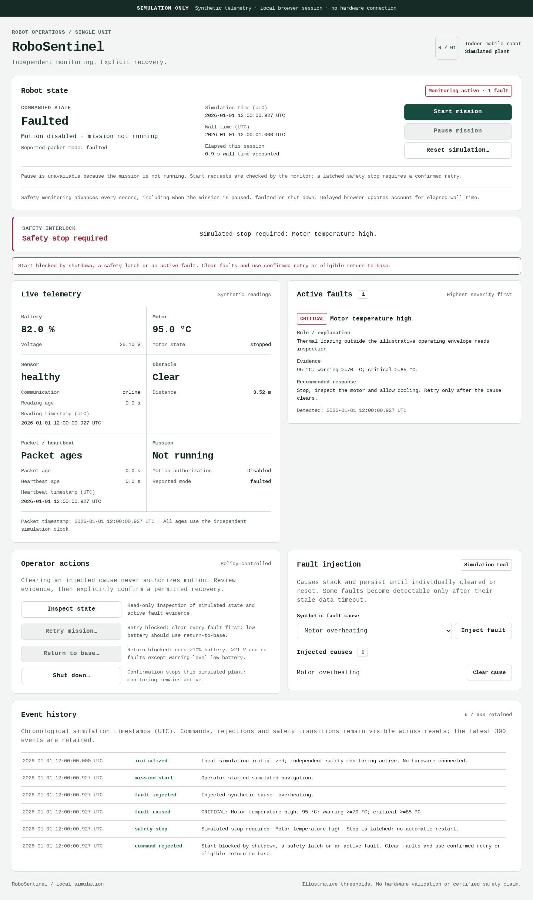

# RoboSentinel

RoboSentinel is a **simulation-first robot monitoring and fault-response system**.
It generates deterministic mobile-robot telemetry, identifies abnormal conditions
with transparent rules, and applies a fail-safe simulated response policy.

> **Simulation only. No hardware drivers, robot commands, cloud services or
> certified safety claims are included.** Thresholds are illustrative demo
> assumptions and must be calibrated and reviewed before any real deployment.

## Who it is for

Robotics students, simulator developers and operator-interface reviewers who
want to exercise observable fault-handling behaviour without connecting motors
or relying on paid/cloud services. The baseline is explainable deterministic
rules, **not machine learning**.

## Features

- Seeded synthetic battery/voltage, motor, sensor, obstacle and heartbeat data
- Seven stackable injected causes and simultaneous severity-prioritized faults
- Independent freshness clock, critical/obstacle stop and latched recovery
- Policy revalidation when a pending operator confirmation is submitted
- Confirmed reset with explicit cleared-condition evidence and retained history
- Responsive telemetry, evidence, recommendations, actions and event dashboard
- Executable acceptance scenarios, offline core tests and optional browser QA

## What a reviewer can demonstrate

1. Launch a local browser dashboard and see a healthy simulated robot.
2. Start the simulated mission and observe live battery, voltage, motor,
   sensors, obstacle, heartbeat and commanded/reported modes.
3. Inject motor overheating and see rule evidence, a critical fault, and a
   latched simulated stop.
4. Attempt recovery and see the safety interlock reject it while the cause is
   present. Clear the cause, then explicitly confirm a monitored retry.
5. Inspect chronological fault, command, rejection, safety-stop and recovery
   events in the dashboard.
6. Run deterministic scenario assertions and the full automated test suite.

## Requirements

- Node.js **22.23.3**, pinned in `.nvmrc` and the Dockerfile (package supports 22+)
- A modern browser with ES module and native `<dialog>` support
- No runtime dependencies, build step, external fonts, API keys or secrets
- `npm ci` below uses the checked-in empty dependency lockfile and works offline.

## Run locally

```bash
npm ci --ignore-scripts --offline --no-audit --no-fund
npm test
npm run check
npm run demo
npm start
```

Open <http://127.0.0.1:3000/>. The server binds to loopback by default. To use
another local port:

```bash
PORT=3100 npm start
```

The server is an explicit allowlist of dashboard and core-module assets. It does
not expose `package.json`, hidden files, repository metadata or arbitrary paths.

With an existing nvm installation, `nvm install && nvm use` selects `.nvmrc`.
Obtaining Node itself requires network; running the app/core checks after that
does not. Windows PowerShell users can set `$env:PORT = '3100'` before `npm start`.

### Container build and local deployment

```bash
docker build -t robosentinel:local .
docker run --rm --name robosentinel -p 127.0.0.1:3000:3000 robosentinel:local
```

Open the same loopback URL. The container binds internally to `0.0.0.0` for port
mapping, runs as the nonroot `node` user, checks health with Node fetch and runs
test/check/demo while building. No extra system packages are needed by the app.
Docker was unavailable in the QA environment: **image build/run NOT TESTED**.
The recipe is supplied, not a claim of a successful container deployment.
Pulling the base image requires network; zero-dependency `npm ci` is offline.
Do not expose this prototype as an authenticated robot service; it has no such API.

### Optional browser checks

`make test` runs the core test, syntax and demo commands. A separate developer
harness in [`qa/`](qa/README.md) exercises the rendered UI with Playwright and
has its own pinned lockfile. It does not add dependencies to the application.

## Fault-injection procedure

The dashboard's **Fault injection** control supports stacked synthetic causes:

| Cause | Expected detection | Default response |
| --- | --- | --- |
| Low battery | Warning at <=20% | Inspect; eligible return-to-base requires confirmation |
| Critical battery | Critical at <=10% or <=21 V | Stop; inspect power; no blind recovery |
| Motor overheating | Warning >=70 °C, critical >=85 °C | Stop when critical; inspect and cool |
| Sensor failure | Critical failed/offline navigation sensor | Stop; inspect and require fresh readings |
| Stale sensor readings | Critical after >3 s | Stop; require fresh readings |
| Communication loss | Critical heartbeat after >3 s | Stop; reject blind motion |
| Obstacle blockage | Warning when detected at <=0.5 m | Stop/pause navigation; inspect route |

Injections persist until individually cleared or reset. Fault detection is
deterministic and sorted by critical, warning, then stable fault id. Every fault
contains its severity, evidence, explanation, detection timestamp and
recommended response.

## Safety model

The response engine is intentionally conservative:

- Critical faults and close detected obstacles require a simulated stop.
- A safety stop is latched. Clearing a cause never restarts motion.
- `start` cannot bypass an active fault or latch.
- `retry`, `return-to-base`, `shutdown` and `reset` require explicit confirmation
  in the core API as well as the UI. An unconfirmed reset is rejected and logged.
- Retry has a fresh one-second monitored recovery check before motion starts.
- If any interlock changes during that check, recovery is cancelled.
- Return-to-base is eligible with no faults or warning-level low battery only,
  >10% battery and >21 V; its five-second transit is synthetic, not a route planner.
- Shutdown disables motion while monitoring continues; reset is required.
- A delayed monitoring callback (>3 s) creates a monitoring-gap critical fault
  before the simulator advances through the unobserved interval.
- The dashboard distinguishes the commanded safety/motion state from the last
  reported telemetry mode. Stale reported data is not authoritative.
- Reset restores the configured plant, logs the cleared conditions and leaves
  motion stopped. Unsafe configured initial conditions are detected again.
- Audit history is the latest 300 events in the current browser tab. It is
  preserved across confirmed resets, **not** durable across reload/tab closure.

No browser action is a real hardware control. `server.js` serves static files;
there is no network endpoint for commanding a robot.

## Architecture

```text
                         browser (public/)
                               |
                        createMonitor()
                               |
       +-----------------------+------------------------+
       |                        |                        |
  simulator.js             detector.js               policy.js
  synthetic plant          pure rules                pure interlocks
       |                        |                        |
       +------------------------+------------------------+
                                |
                         monitor.js
             clock, lifecycle, latch, events, commands
                                |
                         snapshot for UI
```

### Modules

- `src/simulator.js` — seeded synthetic plant, bounded variation, physical
  ranges, modes, timestamps and independent fault injection.
- `src/detector.js` — pure validation and rule-based classification. Malformed,
  future-dated or stale data fails closed.
- `src/policy.js` — pure action eligibility and stop policy. It does not mutate
  state and does not trust UI decisions.
- `src/monitor.js` — authoritative state machine for the local scene, clock,
  fault lifecycle timestamps, safety latch, commands and bounded event history.
- `public/` — accessible responsive dashboard. It renders monitor snapshots and
  never implements its own safety rules.
- `server.js` — local static allowlist with security headers; not a robot API.
- `scenarios/demo.json` and `src/scenarios.js` — checked-in executable scenarios.
- `test/` — simulator, detector, policy, monitor, HTTP surface and scenario tests.

## Telemetry schema

```js
{
  timestamp: 1767268800000,
  heartbeat: 1767268800000,
  battery: { percent: 82, voltage: 25.1 },
  motor: { temperatureC: 39, state: 'stopped' },
  sensor: { health: 'healthy', communication: 'online', timestamp: 1767268800000 },
  obstacle: { detected: false, distanceM: 3.5 },
  mode: 'idle'
}
```

`mode` can be `idle`, `navigating`, `paused`, `faulted` or `recovering`.
Telemetry timestamps are epoch milliseconds. The monitor owns the simulation
clock so tests and demo scenarios do not depend on wall-clock timing.

## Verification and known limitations

The current dependency-free checks are:

```text
npm test      51 passed, 0 failed
npm run check 15 application/core-test JavaScript files syntax-checked
npm run demo 3 deterministic scenarios with assertions passed
bash qa/test-debian.sh 15 automated Chromium browser journeys passed
```

The HTTP test also verifies that the dashboard and core modules are served,
unknown paths are rejected, unsafe repository files are not served, methods are
restricted, and baseline security headers are present.

Known limitations:

- Each browser tab owns an independent in-memory simulation; state is not persisted.
- Browser verification used an isolated headless Chromium 156.0.8078.4 through
  Playwright 1.64.1. Desktop, tablet and 390px/320px controls, confirmation,
  timeouts and failure UI were exercised. The built-in browser timed out; it
  was not used as evidence. Safari, Firefox, human screen-reader QA and
  hardware validation are **NOT TESTED**.
- There is no real kinematics, map, localization, charging model, sensor noise
  calibration, hardware I/O, authentication, multi-robot fleet or durable log.
- A browser tab can be suspended by the OS. The monitor records a monitoring-gap
  fault when it resumes, but no software can guarantee a real hardware stop from
  a suspended browser; this project has no hardware path by design.
- Thresholds are not a safety case. Real deployment needs hazard analysis,
  independent safety controls, calibrated sensor specifications, fault-injection
  evidence and hardware-in-the-loop validation.
- The detector validates each packet, not an external network stream; there is
  no out-of-order-packet ingestion adapter. The monitor's own clock advances
  monotonically and rejects negative/invalid time steps. A future hardware
  adapter would need sequence/replay checks and independent safety controls.
- Docker build/run and hosted GitHub Actions execution are **NOT TESTED** locally.

See [`docs/verification.md`](docs/verification.md) for the baseline, fixes, exact
verification scope, security findings and untested areas. Counts above describe
this release verification, not hardware performance or a coverage percentage.
A separate clean Git checkout also passed offline `npm ci`, all core commands
and CLI server/asset checks at the documented alternate port 3100. Optional QA
dependencies and local tool directories were not needed for that reproduction.

## Reproducible demo from the command line

```bash
npm run demo
```

The scenario transcript is intentionally readable. The first scenario starts a
mission, injects overheating, rejects unsafe retry, clears the cause, and only
then enables motion after confirmed recovery. The second freezes a packet and
shows the independent stale-data response. The third stacks faults and verifies
reset plus retained history. Any expectation mismatch exits non-zero.

For a repeatable 60–90 second walkthrough, follow
[`docs/demo-walkthrough.md`](docs/demo-walkthrough.md). The UI blocks unsafe
recovery controls and displays the reason; the CLI scenario additionally shows
an actual confirmed unsafe retry rejected by the core.

### Genuine browser captures



Additional captures: [healthy/paused desktop](docs/evidence/healthy-desktop.png),
[communication loss](docs/evidence/communication-loss.png),
[390px narrow screen](docs/evidence/narrow-screen.png),
[intentional module-load error](docs/evidence/module-error.png).
These are unmodified screenshots from the automated local test browser with
controlled test time and synthetic telemetry, not photographs or hardware logs.

## Project documents

- [`docs/implementation-plan.md`](docs/implementation-plan.md) — contract,
  boundaries, assumptions and staged verification plan.
- [`DESIGN.md`](DESIGN.md) — visual language, responsive rules and accessibility
  direction for the monitoring cockpit.
- [`scenarios/demo.json`](scenarios/demo.json) — executable acceptance scenarios.
- [`docs/demo-walkthrough.md`](docs/demo-walkthrough.md) — 60–90 second demo script.
- [`docs/verification.md`](docs/verification.md) — bounded QA/security evidence.
- [`docs/submission.md`](docs/submission.md) — submission draft and real blockers.

## GitHub publication

**BLOCKED: no authenticated GitHub account and no configured remote.** No public
repository URL, demo-hosting link or completed Buildathon submission is claimed.
The release work installed a GitHub CLI binary only inside ignored `.tools/`;
`.tools/github/usr/bin/gh auth status` reported no logged-in hosts. Sign in
directly using `.tools/github/usr/bin/gh auth login` (or a trusted system `gh`)
in the same environment; never put tokens in project files or chat.

After login, inspect the authenticated account's repositories before creating
public `robosentinel`; reuse a clearly intended existing repository. Verify the
public URL, README and source after push before adding links to the submission.
The MIT licence is in [`LICENSE`](LICENSE). The configured CI has read-only
permissions, commit-pinned standard actions and no AI/service integrations.
